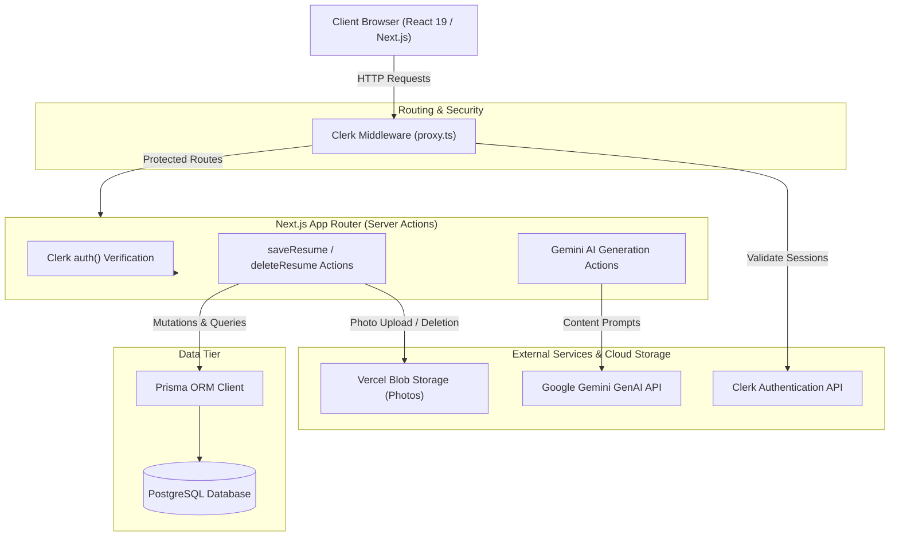
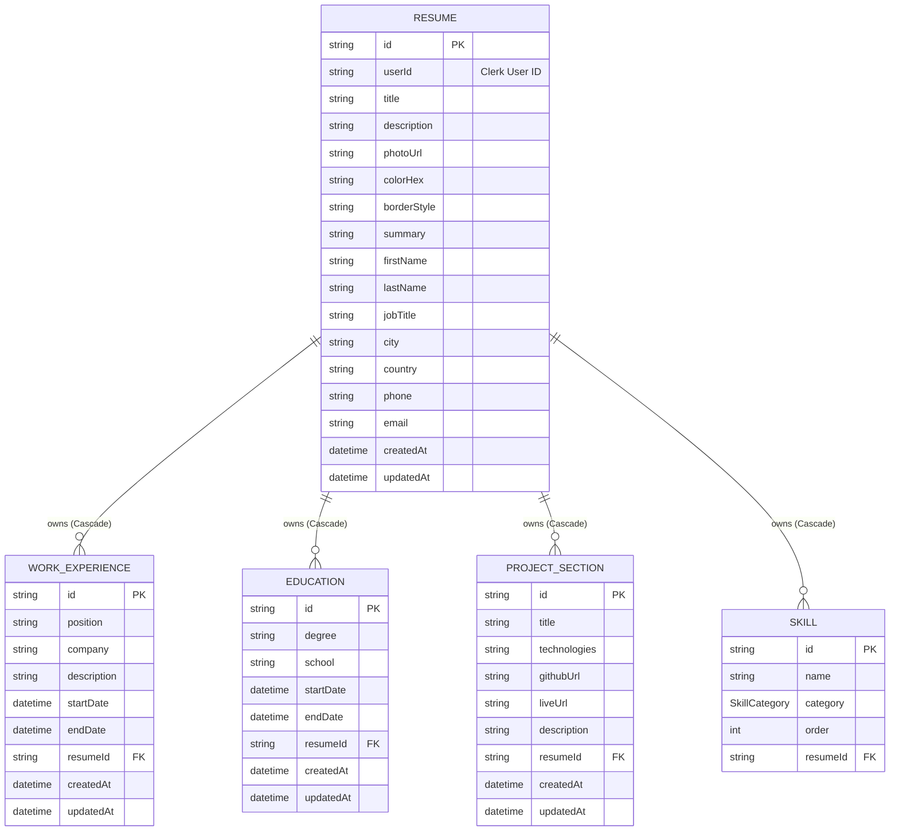
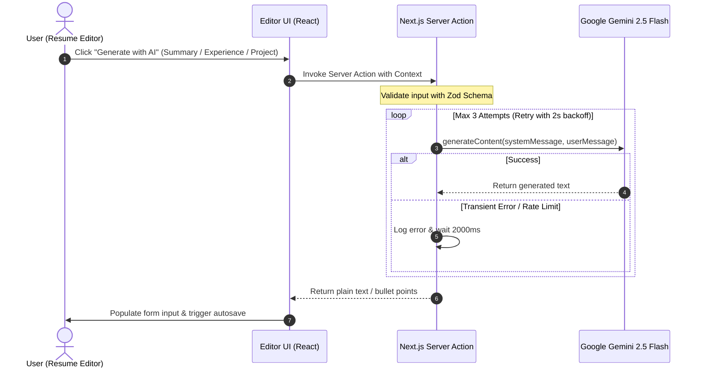

# Forge Architecture Documentation

This document describes the architectural design, core subsystems, data models, and security boundaries of **Forge**, an AI-augmented resume builder web application.

---

## 1. System Overview

Forge is built on the **Next.js App Router** framework (React Server Components and Server Actions), integrating:
- **Authentication**: Managed user sessions and access controls via **Clerk**.
- **Database & Persistence**: Relational data storage using **PostgreSQL** accessed through **Prisma ORM**.
- **AI Acceleration**: Generative resume enhancement using **Google Gemini** (`gemini-2.5-flash`).
- **Asset Storage**: Cloud storage for candidate profile images via **Vercel Blob**.
- **Client Experience**: Reactive multi-step forms with live preview, real-time debounced auto-save, drag-and-drop customization, and PDF/print export.

---

## 2. Data Model & Entity Relationships

The data schema is defined in `prisma/schema.prisma`. A single `Resume` entity owns multiple relational sub-documents: work experiences, education records, project sections, and categorized skills. All relations enforce cascade deletion when the parent resume is deleted.

### Skill Categories
Skills are categorized using the `SkillCategory` enum:
- `LANGUAGE`, `FRONTEND`, `BACKEND`, `DATABASE`, `TOOL`, `CLOUD`, `DEVOPS`, `MOBILE`, `AI`, `CONCEPT`, `OTHER`.

---

## 3. Authentication & Security Boundaries

### 3.1 Route Protection
Route protection is enforced at the network edge using Clerk:
- **Public routes**: `/`, `/sign-in(.*)`, `/sign-up(.*)`.
- **Protected routes**: `/resume`, `/editor`, and all associated API endpoints.
- Any unauthenticated request attempting to reach protected paths is redirected to the sign-in flow.

### 3.2 Tenant Isolation in Server Actions
Every data mutation (`saveResume`, `deleteResume`) and query verifies the authenticated `userId` retrieved server-side from `await auth()`:
- Resumes are strictly scoped to `where: { id, userId }`.
- Cross-user modifications or unauthorized deletions are blocked server-side regardless of client inputs.

### 3.3 File Validation & Storage Limits
Profile picture uploads are validated using Zod:
- Supported format: `image/*` MIME type.
- Maximum file size: `4 MB`.
- Server actions upload payload limits are configured via `experimental.serverActions.bodySizeLimit: "4mb"` in `next.config.ts`.
- Remote image rendering is locked to trusted Vercel Blob domains (`di6codgj9ga0hojc.public.blob.vercel-storage.com`).
- When a candidate's photo is replaced or their resume is deleted, the existing photo blob is purged from Vercel Blob via `@vercel/blob del()`.

---

## 4. AI Generation Pipeline

Forge integrates `@google/genai` with model `gemini-2.5-flash` to offer automated resume drafting and refinement.

### 4.1 AI Actions
1. **`generateSummary`**:
   - Compiles current job title, work experience items, education history, and skills list.
   - Instructs Gemini to craft an ATS-friendly, concise summary without hallucinations.
2. **`generateWorkExp`**:
   - Takes raw work experience notes (minimum 20 characters).
   - Produces 3 to 5 high-impact, ATS-optimized bullet points beginning with action verbs.
3. **`generateProjectDescription`**:
   - Ingests project title and technologies used.
   - Outputs 3 to 5 clean bullet points detailing architecture, problem solved, and technical metrics without Markdown formatting characters (bold/italics).

---

## 5. Editor State Management & Auto-Save Flow

The resume editor consists of a 7-step wizard:
1. **General Info**: Resume title and internal description.
2. **Personal Info**: Contact information, job title, and photo upload.
3. **Work Experience**: Dynamic list of past roles and accomplishments.
4. **Education**: Degrees and educational institutions.
5. **Projects**: Portfolio projects with repository and live links.
6. **Skills**: Categorized skills with custom ordering.
7. **Summary**: Professional candidate summary.

### Auto-save Implementation
- The client maintains form state using `react-hook-form`.
- Changes are watched and debounced via the `useautosave` hook.
- When modifications settle, `saveResume` is triggered asynchronously.
- The server performs an upsert:
  - If a resume ID is present, it updates parent metadata and replaces relational children (`deleteMany` followed by `create`).
  - If new, it creates the parent record and associated child entries in a single Prisma transaction.
- When a new resume is created, the browser URL is seamlessly updated to include `?resumeId=<id>` without causing full page reloads.
